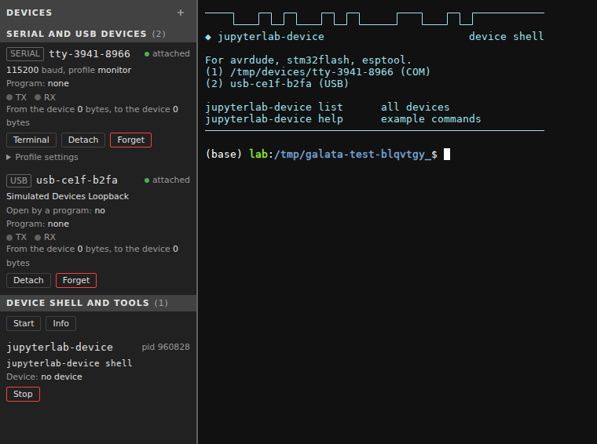
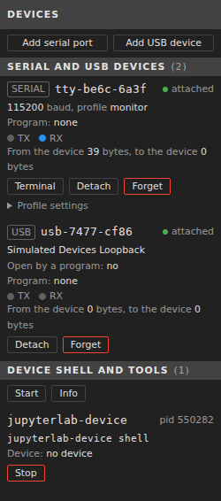

# jupyterlab_device_bridge_extension

[](https://github.com/stellarshenson/jupyterlab_device_bridge_extension/actions/workflows/build.yml)
[](https://www.npmjs.com/package/jupyterlab_device_bridge_extension)
[](https://pypi.org/project/jupyterlab-device-bridge-extension/)
[](https://pepy.tech/project/jupyterlab-device-bridge-extension)
[](https://jupyterlab.readthedocs.io/en/stable/)
[](https://kolomolo.com)
[](https://www.paypal.com/donate/?hosted_button_id=B4KPBJDLLXTSA)

Bridge serial (COM) ports and USB devices of the browser's computer into the JupyterLab container, so terminal programs and AI agents can program and read microcontroller boards.

The container has no access to the hardware. The browser has it, after the user grants one device in Chrome's dialog. The extension carries that device from the browser tab to the programs in the container.

```
board → Windows driver → Chrome tab (Web Serial, WebUSB) → WebSocket → Jupyter server extension → endpoint in the container → terminal programs
```

> [!IMPORTANT]
> The extension is tested against simulated devices in the browser. No test used a physical board. The criteria that need a board are open in [docs/acc-crit-device-bridge.md](docs/acc-crit-device-bridge.md).

The Devices panel with a serial port and a USB device, and a device shell: a lab terminal whose shell runs with the preload shim. The serial port and the USB device in both pictures are simulated in the browser, and the three upload tools that the banner names are empty stand-in programs:



The panel while the simulated port sends bytes. The RX lamp is lit, and the section Device shells lists the device shell. The picture was taken before the section titles of the panel changed, so it shows the earlier titles:



## Features

- **Serial ports in the container** - a port granted in the browser has a virtual serial device at a stable path, which a serial tool opens as it opens a serial port
- **Baud rate of the tool** - the baud rate a tool sets on the virtual device is the baud rate the browser opens the port with
- **Serial settings** - parity, data bits, stop bits and the action on open, with system configs for Arduino, STM32 and ESP boards and named configs the user saves
- **Preload shim** - a tool started with `jupyterlab-device run` has its own DTR, RTS, break and parity calls passed to the port. The panel opens a device shell, a terminal in which every tool has the shim, lists every program that runs with the shim and stops one. A device shell can start in a conda environment or a `.venv` that holds an upload tool
- **Monitor for agents** - the server keeps the most recent bytes received from each port, so a short command-line call reads output that arrived before the call
- **Serial terminal** - a full-screen terminal app of this extension in a JupyterLab terminal, on the virtual device, with keys for the serial settings, the send field and the traffic view
- **USB devices in the container** - a granted USB device answers control, bulk and interrupt transfers of container programs through the command line, a Python client and a pyusb backend
- **Device requests** - a container program asks for a device, and the lab shows the request with a Grant button
- **Panel and status bar item** - the panel lists the devices, the program that holds each serial port or has each USB device open, and the pending device requests; each device row has a TX and an RX lamp that light when bytes pass; a status bar item is visible while any device is attached. The panel is hidden until it is switched on in the View menu
- **Default serial settings** - the baud rate, data bits, parity, stop bits and the action on open that a serial port gets when it is added are settings of the lab
- **Command line and agent skill** - one CLI, `jupyterlab-device`, whose `--help` on every command is written for an AI agent
- **Opened only on the user's grant** - a device is opened only after the user chose it in the browser's dialog, and every server endpoint is behind Jupyter's authentication

## How it works

The lab tab holds the device, and the Jupyter server gives it to the programs in the container. Four parts carry it.

- **Page** - opens the browser's grant dialogs, which exist only in the page, from a button or a command; shows the panel, the status bar item and the menu
- **Web Worker** - a dedicated worker holds every granted device and one WebSocket to the server, and moves every byte between them
- **Server extension** - gives each serial port one virtual serial device (a pty) with a path, a monitor buffer and a socket for the preload shim; passes each USB operation to the tab; keeps the device table and the pending device requests
- **Command line, Python client and pyusb backend** - talk to the server over HTTP on the loopback address, with the server's token

The path of the bytes and of the settings:

- **Tool to board** - a tool writes to the virtual device → the server reads the pty → a binary WebSocket frame → the worker writes the bytes to the port
- **Board to tool** - the worker reads the port → a binary WebSocket frame → the server appends the bytes to the monitor buffer and, while a tool holds the virtual device, writes them to the pty
- **Baud rate** - the server reads the baud rate the tool set on the pty and sends it to the worker; the worker closes the port and opens it again with that baud rate. Before it closes the port it closes the port's writable stream, which by the Web Serial specification waits until the bytes the tool wrote before the change are transmitted; this is not tested with a board. Bytes the tool writes after the change reach the port after the reopen
- **Tool open and close** - the server detects both; on open it applies the port's settings at the tool's baud rate and runs the port's action, on close the port returns to its own settings
- **USB operation** - one call of a program is one HTTP request to the server, one message to the worker and one WebUSB call; the answer goes back through the same parts

## Using it in the lab

The extension adds a panel named **Devices** for the left sidebar, an item in the **View** menu that shows and hides the panel, five commands, a status bar item, settings and an optional **Devices** menu.

### Panel

The panel is off by default: a lab with the default settings has no **Devices** tab in the left sidebar. One of these shows it:

- **View → Show Devices Panel** - the item puts the panel into the left sidebar, opens it and gets a check mark. Chosen again, it takes the panel out of the sidebar
- **Command palette** - the command **Show Devices Panel** does the same
- **Status bar item** - a click on it shows the panel; the item is visible only while a device is attached
- **Settings Editor** - the setting **Show the Devices panel** (`showPanel`); the menu item and the command change this same setting

The choice is stored with the settings of the lab and holds after a page load. Where the lab cannot save the setting, the panel still follows the choice, and a warning says that the lab could not save it. Hiding the panel detaches no device: an attached device stays attached, programs keep their access to it, the status bar item still counts it, and a device request of a program still raises its notification.

The panel has:

- **Plus icon** - in the header of the panel. A click opens a menu with **Connect Serial Port** and **Connect USB Device**; each opens the browser's dialog, and the device the user chooses is attached. A device granted earlier is attached again when the page loads, without a click
- **Section Serial and USB** - one row per device: kind, name, state (`attached`, `detached`, `removed` or `held by another tab`) and the byte counters `RX <bytes>, TX <bytes>`, each a count with its unit: `byte` or `bytes` below 10 KB, `KB` with one decimal from 10 KB, `MB` with one decimal from 1 MB, so 999999 reads `1.0 MB`; the kind chip has a pale blue or pink tint, and its border and text take the same hue in the shade the theme needs; for a serial port also the baud rate, the config (or `custom`), the action on open and the program that holds the virtual device; for a USB device the product name, `Opened: yes` or `Opened: no`, and the name of the program that has it open. With no device the section reads `No device attached`
- **TX and RX lamps** - on every device row; a lit TX lamp is red and a lit RX lamp is green, both JupyterLab CSS variables. They follow the traffic as the LEDs of a USB serial adapter do: a lamp is lit for 200 ms after each event. So sparse traffic gives single flashes, and steady traffic gives a steady light. For a device that another lab tab holds, a lamp flashes once when its byte counter grew, and the counters arrive once a second
- **Terminal** - on an attached serial port; opens the serial terminal
- **Detach** - closes the device. The browser keeps the grant, and **Attach** opens the device again without a dialog
- **Forget** - closes the device, removes it from the list and revokes the browser's grant. The first click changes the button to **Confirm forget**, in the error colour of the theme, the second click acts
- **Settings** - on a serial port; opens the dialog `Serial settings of <name>` with the config, baud rate, data bits, parity, stop bits and the action when a program opens the port. The settings are a table with one row per setting, a hairline between rows and muted labels. The baud rate is an editable field joined to a button that lists the sixteen standard rates 300 to 921600; choosing one writes it into the field and returns the focus, and a value typed outside the list stays as typed. In the footer **Delete config** sits at the far left in the error colour, **Cancel** and **Save as...** are secondary buttons, and **Save** is the only filled button. Choosing a config fills the other fields with its values; changing a field selects `Custom`. **Save** applies the choice at once, **Save as...** stores the five values under a name, **Delete config** removes the user-saved config the port uses, **Cancel** changes nothing
- **Help** - the `help` button at the far right of the Serial and USB header opens the file `Device Bridge Help` in the lab's read-only Markdown Preview; the document explains the panel options, the connections, the tools and the connection configs
- **Section Requests** - each pending device request with the program, the device it asks for, the reason and a **Grant** button. The lab also raises a notification with that button
- **Section Device shells** - one row per program that was started through `jupyterlab-device run` or `jupyterlab-device shell`, in any terminal, also by an agent: the program, its process id, its command line and the device. **Stop** ends the program: the first click changes the button to **Confirm stop**, in the error colour of the theme, the second click acts. **Start** opens a device shell, a lab terminal in which every tool has the preload shim; see [Preload shim](#preload-shim). **Info** is there while a program runs. It shows the path of each attached device and example command lines for avrdude, stm32flash, esptool and pio. With no program the section reads `No device shell opened`
- **Round trip** - the last line, `Round trip: <ms> ms`, shows the measured round trip between browser and server, or `Round trip: not connected`
- **Absent interfaces** - when the browser gives the page no Web Serial or no WebUSB, the panel says so in one line, for example `Web Serial and WebUSB need HTTPS or localhost, in Chrome or Edge`, and the menu of the plus icon has no entry for that interface; with neither interface the plus icon is disabled

### Commands

The commands are in the command palette under **Devices**.

| Command             | Id                             | Does                                                                                                                  |
| ------------------- | ------------------------------ | --------------------------------------------------------------------------------------------------------------------- |
| Connect Serial Port | `device-bridge:connect-serial` | opens the browser's port dialog and attaches the chosen port                                                          |
| Connect USB Device  | `device-bridge:connect-usb`    | opens the browser's device dialog and attaches the chosen device                                                      |
| Serial Terminal     | `device-bridge:open-terminal`  | opens the serial terminal on an attached serial port; asks which port when several are attached                       |
| Device Shell        | `device-bridge:start-run`      | opens a device shell: a lab terminal whose shell runs with the preload shim, so every tool started in it has the shim |
| Show Devices Panel  | `device-bridge:show-panel`     | puts the panel into the left sidebar and opens it; hides the panel when it is shown; also in the **View** menu        |

### Devices menu

The setting **Show the Devices menu** (`showMenu`, default off) adds a **Devices** menu with the five commands to the menu bar. The change takes effect without a reload.

### Settings

The settings are in **Settings → Settings Editor → Device Bridge**. A change takes effect without a reload. The page offers the parity and the action by the names the Devices panel uses; the value in backticks is what the lab stores and what `jupyterlab-device settings set` takes.

| Setting                                      | Id                | Default             | Does                                                                                                                                                                                                                           |
| -------------------------------------------- | ----------------- | ------------------- | ------------------------------------------------------------------------------------------------------------------------------------------------------------------------------------------------------------------------------ |
| Show the Devices panel                       | `showPanel`       | off                 | puts the Devices panel into the left sidebar; the same setting as View → Show Devices Panel                                                                                                                                    |
| Show the Devices menu                        | `showMenu`        | off                 | adds the Devices menu to the menu bar                                                                                                                                                                                          |
| Default baud rate                            | `defaultBaudRate` | 115200              | the baud rate of a serial port that is added; a whole number from 1 to 4294967295                                                                                                                                              |
| Default data bits                            | `defaultDataBits` | 8                   | 7 or 8                                                                                                                                                                                                                         |
| Default parity                               | `defaultParity`   | None (`none`)       | None, Even or Odd; stored as `none`, `even` or `odd`                                                                                                                                                                           |
| Default stop bits                            | `defaultStopBits` | 1                   | 1 or 2                                                                                                                                                                                                                         |
| Default action when a program opens the port | `defaultOnOpen`   | Do nothing (`none`) | the action that runs when a program opens the virtual device: Do nothing (`none`), Pulse DTR (`pulse-dtr`), Pulse RTS (`pulse-rts`), Enter the ESP bootloader (`esp-bootloader`) or Open at 1200 baud and close (`touch-1200`) |

- The five default settings apply to a serial port at the moment it is added: the port gets these values and the system config whose five values equal them, so with the installed defaults it reads `Default`; defaults that match no system config leave it `custom`
- A port that is already in the Devices panel keeps its values when a default changes. That holds after a detach and a page load too, for as long as the Jupyter server runs. A port that was removed with **Forget** gets the defaults when it is added again
- A config applied later to the port, in the Settings dialog of the panel or with `jupyterlab-device settings apply <device> <config>`, replaces these values
- A port shows its action on open and its config, or `custom`, in its line of `jupyterlab-device list`
- With the defaults as they are installed, a port is added with 115200 baud, 8 data bits, no parity, 1 stop bit and no action on open

### Serial terminal

The serial terminal is a full-screen app of this extension. The command starts `jupyterlab-device terminal <name>` in a new lab terminal, which runs the app on the virtual device with the baud rate of the port. That terminal runs this one program, with no shell prompt. Its tab closes when the app ends, and closing the tab ends the app, so the port is free again.

- The top row names the device, its path, the serial settings, the DTR and RTS lines and the bytes received and sent. Below it each line the port sends and each block that is sent has its own line with the time, received bytes in amber and sent bytes in cyan, as text or as hex digits
- Enter sends the typed line, as text with a line ending (LF unless the settings say otherwise) or as hex digits
- Ctrl+Q or Esc quits; Ctrl+O opens the settings: baud rate, data bits, parity, stop bits, the line ending and text or hex. The bottom row lists every key, and Ctrl+Y opens a list of every key with what it does
- Ctrl+C sends the byte 0x03 to the port when no text is selected. Drag with the mouse to select text and press Ctrl+C to copy it: the lab terminal owns the selection and the clipboard, so the port receives no byte. Ctrl+V pastes the first line of the clipboard into the send field. The mouse wheel, Up, Down, PgUp and PgDn scroll the traffic view; while the view is not paused it returns to the end at each new line, so on a port that keeps sending press Ctrl+P before you scroll back or select text, and Ctrl+P again to follow the traffic
- The app opens the virtual device as every tool does: the panel shows it as the holding program, and the port's action on open runs
- A port that is detached or removed leaves the app open with the state `removed`, and nothing is sent until the port is attached again; after Forget, or when the device path failed, it stays removed until it is started again
- The app follows a dark or a light terminal background
- When the command line ends with an error less than 5 seconds after its start, for example because another program holds the port, the terminal stays open with the message until Enter is pressed
- Where the server offers no terminals, or the lab has no `jupyterlab_basic_terminal_extension`, the lab shows the command line to run in a shell of the container
- Where the terminal extension refuses the launch, the lab raises a notification that says the terminal did not start, followed by the reason as the terminal extension gives it, for example `invalid_cwd` when the folder of the file browser no longer exists

### Status bar item

The item is visible only while one device or more is attached to any tab of the lab, so the user sees that programs in the container have access to hardware. It shows the number of attached devices. A click shows the panel; while the panel is switched off, the click switches it on first.

## Serial ports

Each serial port has one virtual serial device in the container: a pty that a tool opens through a path in the device directory.

- **Path** - `<device directory>/<name>`, for example `/run/devices/tty-2341-0043`; `jupyterlab-device list` prints it. The path is outside `/dev`, because the container process is unprivileged
- **Name** - `tty-<vendor id>-<product id>` with 4 hexadecimal digits each, or `tty-port` for a port without USB ids. A second port with the same ids gets the ending `-2`. A port keeps its name and its path over a detach, a page load and a reconnect while the server runs
- **Two boards of one model** - Web Serial gives a port no serial number, so the bridge cannot tell two ports with the same ids apart. After a page load, or in a second lab tab, a name can lead to the other board. Attach one such board at a time when a name must lead to a known board
- **Device directory** - `c.DeviceBridge.device_dir` in the Jupyter server config file names it, and nothing else does. Without the setting it is `/run/devices` when the server's user owns that directory or can make it, else `/tmp/jupyterlab-device-<uid>`; the server log names the directory in use. An image makes `/run/devices` at its start as root, for example with `install -d -m 0700 -o <user> /run/devices`
- **Monitor buffer** - the server keeps the last 262144 bytes each port sent. The server setting `c.DeviceBridge.monitor_bytes` sets another size
- **What the virtual device carries** - data bytes in both directions and the baud rate. A pty refuses the DTR and RTS calls of a tool and holds no parity; these come from the port's settings or from the preload shim
- **Detached port** - the path still opens, and the bytes a tool writes reach no board
- **Killed server** - a server that is killed (SIGKILL, out of memory) leaves its links and sockets in the device directory. The next server that starts on the directory removes them, unless another running server holds the directory. Until then a left link can lead to another pty. A path is valid only for a device that `jupyterlab-device list` prints
- **Stale devices** - a link named `tty-*` or `usb-*`, a link to a pty and a shim socket that belong to no device of the bridge are stale. The server removes them when it starts and each time a lab tab connects, after each page load. Every device the Devices panel lists keeps its path. Other files, folders and links in the device directory stay

### Serial settings

A port has one settings record: the baud rate, data bits, parity and stop bits the browser opens the port with, and the action it runs when a program opens the virtual device. The Settings dialog of the panel, the serial terminal and `jupyterlab-device settings` change it.

The system delivers six read-only configs. The first, Default, holds the built-in values, so a port can always return to them. A user can save the current values of a port under a name, in the Settings dialog or with `jupyterlab-device settings save`; a saved config survives a server restart.

| System config    | Settings   | Action on open   | For                                                      |
| ---------------- | ---------- | ---------------- | -------------------------------------------------------- |
| Default          | 115200 8N1 | `none`           | the built-in values; a port with these values names it   |
| Monitor          | 115200 8N1 | `none`           | reading a board's output                                 |
| Arduino upload   | 115200 8N1 | `pulse-dtr`      | Arduino Uno, Nano and Mega through the serial bootloader |
| Arduino as ISP   | 19200 8N1  | `none`           | an Arduino used as ISP programmer; no action on open     |
| STM32 bootloader | 115200 8E1 | `none`           | STM32 serial bootloader                                  |
| ESP upload       | 115200 8N1 | `esp-bootloader` | ESP32 and ESP8266                                        |

| Action           | Steps on the port                                                                                                                                        |
| ---------------- | -------------------------------------------------------------------------------------------------------------------------------------------------------- |
| `none`           | nothing                                                                                                                                                  |
| `pulse-dtr`      | DTR off, 100 ms, DTR on                                                                                                                                  |
| `pulse-rts`      | RTS off, 100 ms, RTS on                                                                                                                                  |
| `esp-bootloader` | DTR off and RTS on, 100 ms, DTR on and RTS off, 50 ms, both off                                                                                          |
| `touch-1200`     | the port is closed, opened at 1200 baud, DTR is set off, the port is closed and, after 500 ms, opened again with the earlier settings if it still exists |

- A system config cannot be changed or deleted. To make your own, apply a system config to a port, change the fields, then **Save as...**: the values are stored under your name and the system config stays as it was
- The saved configs live in `serial-settings.json` in the Jupyter data directory, under `jupyterlab-device-bridge`, mode `0600`. A name of 1 to 64 characters; a name or id of a system config or of another saved config is refused. Deleting a saved config that a port uses leaves the port with its values and makes it custom
- Applying a config copies its five values onto the port and names the config; changing one field makes the port custom
- While a tool holds the virtual device, the baud rate is the one the tool sets. Data bits, parity and stop bits are the port's, unless the tool runs with the preload shim
- While no tool holds it, the port is open with its own settings, and the monitor buffer records what the board sends
- The action on open runs each time a program opens the virtual device, the serial terminal included. `monitor read` and `monitor write` do not open the virtual device and run no action
- A config is enough for a tool that continues after the virtual device refused its DTR or RTS call. It is not enough for a tool that sets parity or 7 data bits itself: on the virtual device such a tool gets an error from its settings call or reads back 8N1, and needs the preload shim

### Preload shim

`jupyterlab-device run --device <name> -- CMD` starts a tool with a small library (`LD_PRELOAD`) that passes the tool's own DTR and RTS calls, its break, and its parity, data bits and stop bits to the port.

- **Packaging** - the wheel carries the C source of the library and stays pure Python. `jupyterlab-device run` builds the library on first use with the system C compiler (`cc` or `gcc`) into `~/.cache/jupyterlab-device-bridge/` and uses that file again afterwards
- **No C compiler** - `run` stops with exit status 1 and a message that names the port's settings as the way that needs no shim
- **Statically linked tool** - a statically linked tool does not load the shim, so only the port's settings serve it
- **Order** - a DTR, RTS or break call returns to the tool after the lab tab applied it, or after 1 s
- **Device shell** - `jupyterlab-device shell` starts the shell of the lab's terminals with the shim: the shell command that the Jupyter server starts in a terminal, whichever shell that is. Every tool started in that shell has the shim, without `jupyterlab-device run --device <name> --` in front. The shell first prints a banner, 75% of the terminal's width, that opens with DEVICE BRIDGE in block letters. Its sections name the environment and the upload tools that are installed, of avrdude, stm32flash, esptool and pio, or say to install one; list each attached device, a serial port by its path with its settings and action on open and a USB device by its name with its ids; say where the agent skill is and whether an agent finds it; and name five commands. Its colours follow the dark or light background of the terminal; with the variable `NO_COLOR` set it has no colour
- **Environment of the device shell** - when a conda environment, or the `.venv` of the folder the shell starts in, holds an upload tool, `jupyterlab-device shell` on a terminal first shows a list of the environments with their tools. Enter starts the shell in the highlighted environment, with its `bin` first on `PATH` and the variables its activation sets, as a line under the question says; Esc keeps the current environment. The banner then names the chosen environment with its tools
- **Device shell from the panel** - the **Start** button of the panel and the command **Device Shell** run `jupyterlab-device shell` in a new lab terminal, in the folder of the file browser. `exit`, or **Stop** in the panel, ends the shell, and the tab of the terminal closes. When the shell cannot start, for example because the container has no C compiler, the terminal stays open with the message until Enter is pressed
- **Shown in the panel** - `run` reports the program to the server before it starts it, so the panel lists the program while it lives, also one that an agent started. **Stop** sends the program `SIGHUP`, and `SIGKILL` 3 s later when it still lives. A shell ends on `SIGHUP` together with the tool that runs in it
- **Tested with** - gcc and glibc 2.39 on x86-64 Linux, with Python programs and pyserial as the tool

## USB devices

A USB device has no path in the container. A program reaches it through `jupyterlab-device usb`, through the Python client or through the pyusb backend, and each operation is one WebUSB call in the lab tab.

- **Name** - `usb-<vendor id>-<product id>`, for example `usb-0483-3748`; `jupyterlab-device usb list` prints it
- **Operations** - open, close, select configuration, claim and release interface, select alternate setting, control transfer in and out, bulk and interrupt transfer in and out, clear halt, reset; `jupyterlab-device usb describe` prints the configurations, interfaces, endpoints and strings
- **Errors** - a refusal of the browser reaches the program with the browser's own error name and message; a transfer the device ended with a stall is an error with the name `stall`
- **Transfer in without data** - it fails when its timeout ends, and the bytes that arrive later are returned by the next transfer in on that endpoint

### Device requests

A program cannot grant a device. It asks, and the user decides.

```bash
jupyterlab-device request usb --vid 0483 --pid 3748 --reason "flash the board through the ST-Link"
```

- The lab shows the request in the panel and as a notification, each with a **Grant** button. The click opens the browser's dialog, filtered to that vendor and product id
- The command waits, for 300 s unless `--timeout` says otherwise. Exit status 0 and the device name on stdout: granted. 1: denied, with the browser's reason on stderr. 2: nobody answered
- `jupyterlab-device request serial` asks for a serial port in the same way
- In Python: `DeviceBridgeClient().request_device("usb", "the reason", 0x0483, 0x3748)`, then `request_state(id, wait=5)` until the state is no longer `pending`

### Python client

`jupyterlab_device_bridge_extension.client` finds the server and its token as the command line does. A program in another Python environment needs the extension installed in that environment, because importing the package needs `jupyter_server`.

```python
from jupyterlab_device_bridge_extension.client import DeviceBridgeClient

bridge = DeviceBridgeClient()
probe = bridge.usb("usb-0d28-0204")
probe.open()
probe.claim_interface(0)
probe.transfer_out(1, b"\x00\x02")
answer = probe.transfer_in(1, 64, timeout_ms=1000)
```

- `UsbDevice` has one method per operation: `describe`, `open`, `close`, `reset`, `select_configuration`, `claim_interface`, `release_interface`, `select_alternate`, `clear_halt`, `control_in`, `control_out`, `control`, `transfer_in`, `transfer_out`
- A failure raises `DeviceBridgeError` with `status`, `message`, and for a refusal of the browser its error `name`
- `bridge.serial(name)` gives the serial side: `record`, `set_settings`, `monitor`, `write`, `signals`, `action`

### pyusb backend

`jupyterlab_device_bridge_extension.pyusb_backend` is a pyusb backend on top of the client. pyusb is not installed with the extension; the program that uses the backend brings it.

A program that passes a backend to pyusb takes it from `pyusb_backend.get_backend()`:

```python
import usb.core
from jupyterlab_device_bridge_extension import pyusb_backend

probe = usb.core.find(idVendor=0x0D28, idProduct=0x0204, backend=pyusb_backend.get_backend())
```

A program that passes no backend is pointed at the bridge with `pyusb_backend.install()`, called before the program's first search. After that call `usb.core.find` without a backend argument uses the bridge, and so do `libusb_package.find` and `libusb_package.get_libusb1_backend` where the package `libusb_package` is installed.

pyOCD is such a program: it finds ST-Link and CMSIS-DAP v2 probes through pyusb with the backend of `libusb_package` (from knowledge). It is started from Python, after `install()`:

```bash
python -c "from jupyterlab_device_bridge_extension import pyusb_backend; pyusb_backend.install(); from pyocd.__main__ import main; main()" list
```

- This was not run against pyOCD. pyOCD is not installed in the test environment, the test of `install()` uses a stand-in for `libusb_package`, and the entry point `pyocd.__main__.main` is from knowledge
- A search through the backend opens each attached USB device that is closed, reads its descriptors with control transfers and closes it again
- A pyusb timeout of 0 means the 5 s of the bridge, not an endless wait
- Isochronous transfers are not offered

## Windows drivers

On Windows the browser reaches a device only through the driver that Windows has bound to it. The table is from knowledge and was not tested here.

| Device kind                                                                            | Reached through                                       | Windows driver it needs                             |
| -------------------------------------------------------------------------------------- | ----------------------------------------------------- | --------------------------------------------------- |
| Device with a COM port: a board with a USB serial chip, a USB to serial adapter        | Web Serial                                            | its serial driver, which gives it the COM port      |
| CMSIS-DAP v2 debug probe                                                               | WebUSB                                                | WinUSB, which the probe declares itself             |
| ST-Link debug probe                                                                    | WebUSB                                                | ST's driver package                                 |
| USBasp programmer                                                                      | WebUSB                                                | WinUSB, installed with Zadig                        |
| STM32 in its DFU bootloader                                                            | WebUSB                                                | WinUSB, installed with Zadig or STM32CubeProgrammer |
| Device of the class audio, HID, mass storage, smart card, video or wireless controller | not reachable: Chrome blocks these classes for WebUSB | no driver changes that                              |

- WebUSB cannot claim an interface that Windows has bound to another driver. A COM port belongs to the serial driver, so a serial device goes through Web Serial
- A board that changes into bootloader mode can appear as a different device (Arduino Leonardo and Micro, STM32 DFU, Digispark) and needs its own grant
- A C tool that uses libusb cannot reach a bridged USB device in this version; see Limits

## Working with an AI agent

An agent in a lab terminal uploads firmware with the board's own tool on the virtual device and reads the board's output with `jupyterlab-device monitor read`. The `--help` of every command is written to be read by an agent.

> [!WARNING]
> No command line of this section was run against a board or against the real upload tool: avrdude, stm32flash, esptool and pyOCD are not installed in the test environment. The options of these tools are from knowledge.

For every board:

- `jupyterlab-device list` prints the name, the state and the path of each device. The names and the paths below are examples
- No program can grant a device. With no device in the list, `jupyterlab-device request serial --reason "<why>"` shows a request in the lab and waits until the user presses Grant
- Upload only to a device in the state `attached` whose line shows no `error:`. A line of an attached port that ends with `error: <reason>` means the port failed in the browser, for example the browser could not open it, and the browser does not open it again by itself: tell the user the reason and, when the cause is gone, apply a config again with `jupyterlab-device settings apply <device> <config>`, which asks the browser to open the port again, then run `jupyterlab-device list` again
- Apply the config of the board before the upload, and the Monitor config before the serial terminal is opened: the action on open runs at every open
- `monitor read` prints what the port sent, also before the call, and does not open the virtual device. The buffer also holds the bytes the bootloader sent during the upload: `--lines 0 --follow --timeout <seconds>` prints only new output, `--lines <n>` the last lines of the buffer
- `monitor read` shows readable text only when the port is open at the baud rate of the firmware. While no tool holds the device that is the port's baud rate, and `jupyterlab-device settings set <device> --baud <n>` sets it
- `jupyterlab-device terminal` needs a person at a terminal. An agent reads with `monitor read` and writes with `monitor write`, never with `terminal`

### Installers of the firmware tools

No installer is in this repository or in the wheel. The three installers and the module they import are in the template of the copier embedded project at <https://github.com/stellarshenson/copier-embedded-project>, under `template/resources/envs`: `firmware-avr.py`, `firmware-stm32.py`, `firmware-esp.py` and `firmware_env.py`. Each installer creates one conda environment with the tools that build firmware and upload it:

- `firmware-avr.py` - environment `firmware-avr`: nightly Rust with its source, avr-gcc, avrdude, PlatformIO with the Arduino AVR core, simavr, ngspice, pytest
- `firmware-stm32.py` - environment `firmware-stm32`: Rust with six Cortex-M targets, cargo-binutils, PlatformIO 6.2.0 with the ststm32 platform, STM32Cube HAL and Arduino, QEMU with an STM32F405 machine, stm32flash, ngspice
- `firmware-esp.py` - environment `firmware-esp`: Rust for the ESP32 chips, espflash, esptool, PlatformIO with the ESP8266 core, ngspice

The three import `firmware_env.py`, so the four files must be in one folder. An installer is a `uv` script and runs as a program, for example `template/resources/envs/firmware-avr.py` in a clone of that project. It needs `uv`, x86-64 Linux, access to the internet, and conda at `/opt/conda/bin/conda` or at the path in the variable `CONDA_CMD`. No test of this extension ran an installer.

### AVR boards with avrdude

The config `Arduino upload` pulses DTR when avrdude opens the virtual device. The virtual device refuses avrdude's own DTR call; avrdude prints a warning and continues (from knowledge).

```bash
jupyterlab-device settings apply tty-2341-0043 "Arduino upload"
avrdude -c arduino -p atmega328p -b 115200 -P /run/devices/tty-2341-0043 -U flash:w:firmware.hex:i
jupyterlab-device monitor read tty-2341-0043 --lines 0 --follow --timeout 10
```

| Board                              | avrdude options                                                             | Config         |
| ---------------------------------- | --------------------------------------------------------------------------- | -------------- |
| Arduino Uno                        | `-c arduino -p atmega328p -b 115200`                                        | Arduino upload |
| Arduino Nano                       | `-c arduino -p atmega328p -b 115200`, or `-b 57600` with the old bootloader | Arduino upload |
| Arduino Mega 2560                  | `-c wiring -p atmega2560 -b 115200`                                         | Arduino upload |
| ATtiny85 through an Arduino as ISP | `-c stk500v1 -p attiny85 -b 19200`                                          | Arduino as ISP |

An ATtiny is programmed through an Arduino that runs the ArduinoISP sketch. The config `Arduino as ISP` runs no action on open and has the 19200 baud of that sketch, so the bridge changes no control line and does not reopen the port when avrdude opens the virtual device.

```bash
jupyterlab-device settings apply tty-2341-0043 "Arduino as ISP"
avrdude -c stk500v1 -p attiny85 -b 19200 -P /run/devices/tty-2341-0043 -U flash:w:firmware.hex:i
```

### STM32 boards with stm32flash and pyOCD

**stm32flash** writes through the serial bootloader of the chip, over a USB to serial adapter. The board must be in its serial bootloader before the upload; the bridge does not put it there. stm32flash sets even parity itself and reads its settings back (from knowledge), so it runs with the preload shim.

```bash
jupyterlab-device settings apply tty-0403-6001 "STM32 bootloader"
jupyterlab-device run --device tty-0403-6001 -- stm32flash -b 115200 -w firmware.bin -v -g 0x0 /run/devices/tty-0403-6001
jupyterlab-device settings apply tty-0403-6001 Monitor
jupyterlab-device monitor read tty-0403-6001 --lines 0 --follow --timeout 10
```

**pyOCD** writes through a debug probe, an ST-Link or a CMSIS-DAP v2 probe, which is a USB device. pyOCD is pointed at the bridge as the section USB devices describes. This was not run against pyOCD.

```bash
jupyterlab-device request usb --vid 0483 --pid 3748 --reason "flash the STM32 through the ST-Link"
python -c "from jupyterlab_device_bridge_extension import pyusb_backend; pyusb_backend.install(); from pyocd.__main__ import main; main()" flash --target stm32f103c8 firmware.bin
```

The serial output of the board comes through a serial port and is read with `monitor read`, as above.

### ESP32 and ESP8266 with esptool

esptool resets the chip with DTR and RTS itself. The virtual device refuses these calls unless esptool runs with the preload shim, so there are two ways.

**On a config, without the shim** - the config `ESP upload` runs the bootloader entry sequence when esptool opens the virtual device, and `--before no-reset --after no-reset` tell esptool to make no reset of its own.

```bash
jupyterlab-device settings apply tty-10c4-ea60 "ESP upload"
esptool --port /run/devices/tty-10c4-ea60 --before no-reset --after no-reset write-flash 0x0 firmware.bin
jupyterlab-device settings apply tty-10c4-ea60 Monitor
jupyterlab-device signals tty-10c4-ea60 --rts 1
jupyterlab-device signals tty-10c4-ea60 --rts 0
jupyterlab-device monitor read tty-10c4-ea60 --lines 20
```

- From knowledge: after `--after no-reset` the chip stays in its bootloader, and RTS on, then off, is the reset pulse of the usual reset circuit of ESP development boards. The two `signals` commands send that pulse

**With the shim, with esptool's own reset** - the config `Monitor` runs no action on open, so only esptool's own DTR and RTS sequence reaches the port.

```bash
jupyterlab-device settings apply tty-10c4-ea60 Monitor
jupyterlab-device run --device tty-10c4-ea60 -- esptool --port /run/devices/tty-10c4-ea60 write-flash 0x0 firmware.bin
jupyterlab-device monitor read tty-10c4-ea60 --lines 20
```

- esptool before version 5 writes these option values and commands with an underscore: `no_reset`, `write_flash` (from knowledge)

### PlatformIO

pio does not find the virtual device by itself: name its path with --upload-port for an upload and with --port for pio device monitor, or set upload_port and monitor_port in platformio.ini. The upload runs under `jupyterlab-device run`, because the upload tool that pio starts, for example avrdude or esptool, sets DTR and RTS itself. `pio device monitor` is an interactive terminal for a person; an agent reads with `monitor read`.

```bash
jupyterlab-device settings apply tty-2341-0043 Monitor
jupyterlab-device run --device tty-2341-0043 -- pio run -t upload --upload-port /run/devices/tty-2341-0043
pio device monitor --port /run/devices/tty-2341-0043 --baud 115200
jupyterlab-device monitor read tty-2341-0043 --lines 0 --follow --timeout 10
```

The two keys in `platformio.ini`, under the environment of the board, make the options unnecessary:

```ini
[env:uno]
upload_port = /run/devices/tty-2341-0043
monitor_port = /run/devices/tty-2341-0043
```

- The environment `firmware-avr` of the installers holds pio with the Arduino AVR core. The tests ran the real `pio device monitor` on a virtual device with a simulated tab. The upload ran only with a stand-in program for pio, which sets DTR and RTS as an upload tool does; no real pio upload was run

### Agent skill

The agent skill, [`.agents/skills/jupyterlab-device-bridge-extension/SKILL.md`](.agents/skills/jupyterlab-device-bridge-extension/SKILL.md), tells an agent to read `jupyterlab-device --help` first and adds only the rules the help cannot state. One rule names the installers of the firmware tools, which are in the template of the copier embedded project at <https://github.com/stellarshenson/copier-embedded-project> under `template/resources/envs`; this extension ships none. The skill's `references/device-reference.md` gives one format for documenting a device and the procedure to research it, and `references/devices/turmo-usb-monitor.md` is a worked example; an agent saves a new reference under `references/devices/` of a project made from that template. The skill is in the repository and in the wheel, which installs it at `<sys.prefix>/share/jupyter/agents/skills/jupyterlab-device-bridge-extension/SKILL.md`. No agent reads that directory, so one of the two links below makes the skill readable.

After `pip install`, with the Python that runs the lab:

```bash
mkdir -p ~/.agents/skills && ln -s "$(python -c 'import sys; print(sys.prefix)')/share/jupyter/agents/skills/jupyterlab-device-bridge-extension" ~/.agents/skills/jupyterlab-device-bridge-extension
```

From a clone:

```bash
ln -s "$PWD/.agents/skills/jupyterlab-device-bridge-extension" ~/.claude/skills/jupyterlab-device-bridge-extension
```

## Command line

`jupyterlab-device` is the one command. It runs in a terminal of the lab, finds the running Jupyter server and its token itself, and talks to the server on the loopback address without a proxy. `jupyterlab-device --help` and `jupyterlab-device <command> --help` hold the full reference with examples. `jupyterlab-device help` and `jupyterlab-device help <command>` print the same, and `jupyterlab-device --version` prints the version.

| Command                                                                                            | Does                                                                                                |
| -------------------------------------------------------------------------------------------------- | --------------------------------------------------------------------------------------------------- |
| `list [--json]`                                                                                    | lists the devices with path, state, holder and settings                                             |
| `status [--json]`                                                                                  | shows the server, its lab tabs, the browser interfaces and the round trip                           |
| `settings list [--json]`                                                                           | lists the system and the saved serial settings configs                                              |
| `settings show <device> [--json]`                                                                  | prints the config, the settings and the action on open of a serial port                             |
| `settings apply <device> <config>`                                                                 | applies a system or saved config to a serial port                                                   |
| `settings set <device> [--baud N] [--data-bits N] [--parity P] [--stop-bits N] [--on-open ACTION]` | changes single fields of a serial port; the port becomes custom                                     |
| `settings save <device> <name>`                                                                    | saves the current settings of a serial port under a name                                            |
| `settings delete <config>`                                                                         | deletes a user-saved config                                                                         |
| `monitor read <device> [--lines N] [--follow] [--timeout S] [--raw]`                               | prints the buffered output of a serial port; with `--follow` also new output until the timeout ends |
| `monitor write <device> [TEXT] [--hex] [--newline]`                                                | sends bytes to a serial port; standard input when no text is given                                  |
| `terminal <device> [--baud N]`                                                                     | opens the serial terminal app on a serial port, for a person at a terminal                          |
| `signals <device> [--dtr N] [--rts N]`                                                             | sets the DTR and RTS lines of a serial port, 1 or 0                                                 |
| `action <device> <action>`                                                                         | runs one action on a serial port                                                                    |
| `run --device D -- CMD [ARG ...]`                                                                  | starts a tool with the preload shim                                                                 |
| `shell`                                                                                            | starts a device shell: the shell of the lab's terminals with the preload shim                       |
| `help [COMMAND ...]`                                                                               | prints the help of the tool or of one command, as `--help` does                                     |
| `request {serial,usb} [--vid HEX] [--pid HEX] --reason TEXT [--timeout S]`                         | asks the user to grant a device                                                                     |
| `usb list`                                                                                         | lists the USB devices                                                                               |
| `usb describe <device>`                                                                            | prints the descriptors of a USB device as JSON                                                      |
| `usb open <device>`, `usb close <device>`, `usb reset <device>`                                    | opens, closes or resets the device in the browser                                                   |
| `usb claim <device> <interface>`, `usb release <device> <interface>`                               | claims or releases an interface                                                                     |
| `usb configuration <device> <value>`                                                               | selects a configuration                                                                             |
| `usb alternate <device> <interface> <setting>`                                                     | selects an alternate setting of an interface                                                        |
| `usb clear-halt <device> <endpoint>`                                                               | clears the halt of an endpoint                                                                      |
| `usb control <device> REQUEST_TYPE REQUEST VALUE INDEX [--length N] [--data HEX] [--timeout MS]`   | runs one control transfer; bit 7 of REQUEST_TYPE gives the direction                                |
| `usb transfer <device> ENDPOINT [--length N] [--data HEX] [--timeout MS]`                          | runs one bulk or interrupt transfer; bit 7 of ENDPOINT gives the direction                          |

- Results go to stdout and messages to stderr. Bytes of a USB transfer are printed and given as hexadecimal digits
- `jupyterlab-device --help` ends with one example command line for each upload tool that is installed: it looks for avrdude, stm32flash, esptool and pio on `PATH` at that moment and shows the lines of the section [Working with an AI agent](#working-with-an-ai-agent) for the ones it finds. So the help shows more after a conda environment with such a tool was activated. The path in an example is the placeholder `<path>`; `jupyterlab-device list` prints the real path
- Exit status 0: done. 1: not done, and one line on stderr names the reason and the next step. 2: wrong arguments, and for `request` nobody answered in time. 130: stopped with Ctrl+C
- `run` and `shell` exit with the status of the program they started, and with 127 when it cannot be started. `terminal` exits 0 after Ctrl+Q or Esc, 1 when another program holds the device or its path cannot be opened, and 2 without a terminal
- The server is the one this lab names: the record whose base URL is `JUPYTERHUB_SERVICE_PREFIX`, or, when the variable is unset, the only listed server. Several servers with no match are refused. With no matching record the address is `127.0.0.1` on `JUPYTER_PORT` (default 8888) under the prefix. The token is `JUPYTERHUB_API_TOKEN` or `JPY_API_TOKEN` when one is set, else the token of the listed server, else `JUPYTER_TOKEN`

## Security

- **Authentication** - every HTTP endpoint and the WebSocket of the server extension are behind Jupyter's authentication, and a request without credentials is refused. The command line and the Python client find the server on the loopback address and send the server's token there, without a proxy
- **Grant** - a device is opened only after the user chose it in the browser's dialog. The extension opens that dialog only from a button or a command of the lab. A container program can only post a request, which the user answers with the Grant button, and the worker opens only the devices the browser lists as granted
- **Detach and Forget** - Detach closes the device and keeps the browser's grant; Forget revokes the grant
- **One tab per device** - one lab tab holds a device. The server refuses the claim of another tab, and that tab shows the device as held by another tab, without Detach and without Forget. When the holding tab closes, the device is detached, and no other tab takes it by itself
- **Device directory** - the server makes it with mode `0700`. Before each use it must be a real directory, not a symlink, that the server's user owns; else the server refuses it and logs the reason. It holds symlinks to pty slaves and, in `.shim/`, the Unix sockets of the preload shim with mode `0600`. Two servers of one user need two device directories
- **Device names** - the server checks a device name against `[a-z0-9-]{1,64}` before it uses the name
- **Inside the container** - every process of the server's user can open a virtual serial device, and every process that has the server's token can use the bridge. The status bar item shows that devices are attached

## Limits

The first version does not have:

- A replacement libusb library for C tools (avrdude with USBasp, dfu-util, OpenOCD, st-flash)
- WebHID devices (CMSIS-DAP v1 probes, HID bootloaders)
- Kernel routes for a privileged container (USB/IP, CUSE)
- Upload protocols that run inside the browser
- Isochronous transfers
- probe-rs

## Requirements

- JupyterLab >= 4.6 and Jupyter Server >= 2.21
- Python >= 3.10
- The Jupyter server on Linux: the server extension uses ptys and `/proc`
- A browser with the Web Serial and WebUSB interfaces; from knowledge these are desktop Chrome and Edge
- The lab opened over HTTPS or at `localhost`; on a plain `http://` address that is not localhost the browser does not offer these interfaces
- A C compiler (`cc` or `gcc`) in the container, only for `jupyterlab-device run` and `jupyterlab-device shell`
- `jupyterlab_basic_terminal_extension` >= 1.0.9 and `/bin/bash` on the server, for the two commands of the lab that open a terminal; pip installs that extension together with this one. Closing the tab ends the program and frees the port
- pyusb in the program's environment, only for the pyusb backend

## Install

To install the extension, execute:

```bash
pip install jupyterlab_device_bridge_extension
```

## Uninstall

To remove the extension, execute:

```bash
pip uninstall jupyterlab_device_bridge_extension
```
